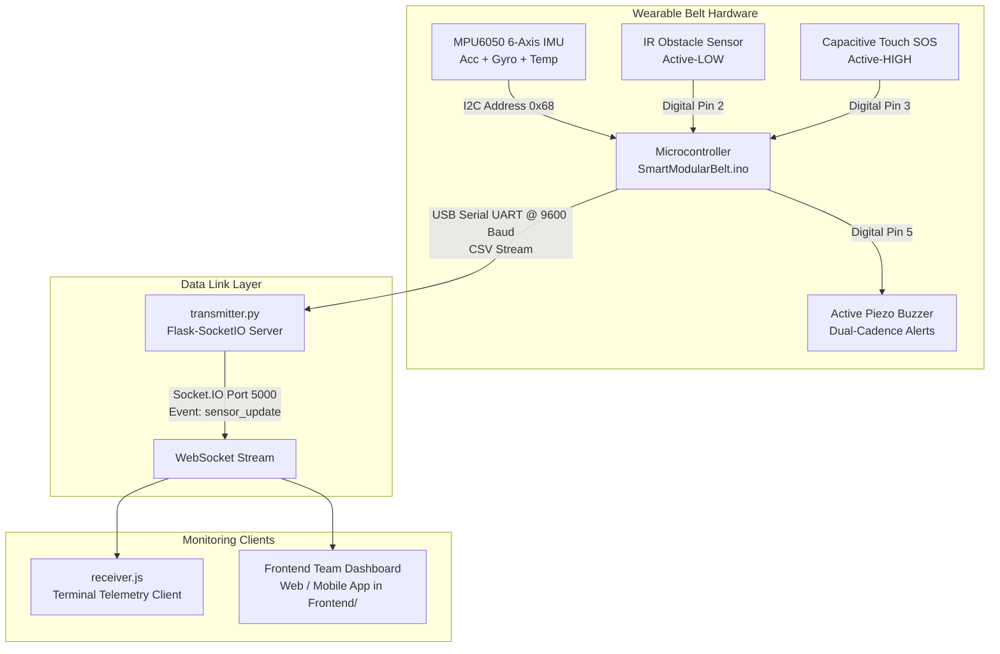
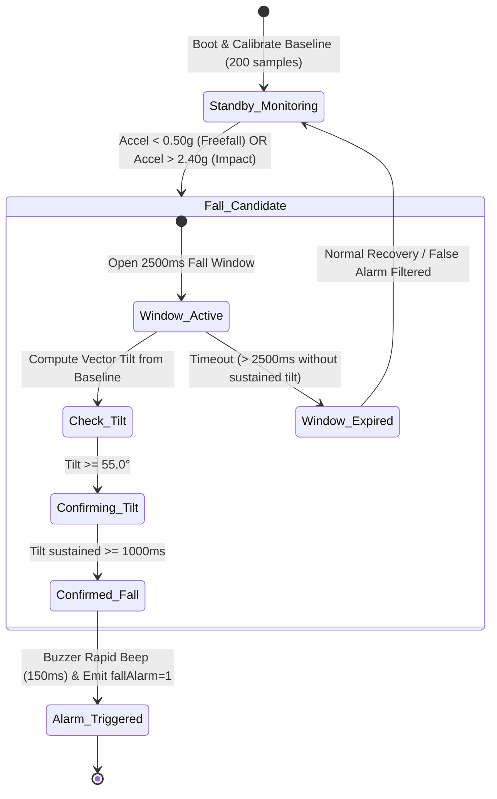

# 🛡️ Smart Modular Belt for Elderly & Specially-Abled Individuals

[](https://opensource.org/licenses/MIT)
[](https://www.arduino.cc/)
[](https://www.python.org/)
[](https://nodejs.org/)
[](https://socket.io/)
[](#)

An intelligent, non-invasive wearable IoT healthcare device engineered to safeguard senior citizens and specially-abled individuals. The belt incorporates **multi-stage inertial fall detection**, **real-time infrared obstacle proximity warning**, **capacitive touch emergency SOS panic triggering**, and a **low-latency WebSocket data link** to stream telemetry to the frontend monitoring system.

---

## 📑 Table of Contents

- [Overview & Problem Statement](#-overview--problem-statement)
- [System Architecture](#-system-architecture)
- [Key Features](#-key-features)
- [Hardware Specifications & Bill of Materials](#-hardware-specifications--bill-of-materials)
- [Pinout & Wiring Diagram](#-pinout--wiring-diagram)
- [Fall Detection Algorithm & Mathematics](#-fall-detection-algorithm--mathematics)
- [Repository Structure](#-repository-structure)
- [Telemetry Data & Socket.IO Contract](#-telemetry-data--socketio-contract)
- [Step-by-Step Installation & Setup](#-step-by-step-installation--setup)
  - [Step 1: Hardware Assembly & Arduino Firmware](#step-1-hardware-assembly--arduino-firmware)
  - [Step 2: Python Data Link Gateway (transmitter.py)](#step-2-python-data-link-gateway-transmitterpy)
  - [Step 3: Node.js Telemetry Receiver (receiver.js)](#step-3-nodejs-telemetry-receiver-receiverjs)
  - [Step 4: Frontend Integration Guide (For Frontend Team)](#step-4-frontend-integration-guide-for-frontend-team)
- [Testing & Calibration Guide](#-testing--calibration-guide)
- [Troubleshooting & FAQs](#-troubleshooting--faqs)
- [Future Roadmap](#-future-roadmap)
- [License & Authors](#-license--authors)

---

## 🎯 Overview & Problem Statement

Falls are among the leading causes of unintentional injury deaths and long-term disability worldwide, especially among the elderly and people with mobility challenges. Additionally, visually impaired or specially-abled individuals regularly encounter unseen low obstacles, elevation changes, or emergencies where pressing small mechanical buttons is difficult.

The **Smart Modular Belt** solves these challenges by combining:
1. **Accurate Fall Detection**: Continuously monitors acceleration and body orientation to detect falls and distinguish them from ordinary daily movements (sitting, walking, bending).
2. **Obstacle Detection**: An active infrared beam detects obstacles or steps ahead, warning the user via acoustic tones.
3. **Touch SOS Panic Button**: An accessible capacitive touch sensor provides immediate panic signaling with zero actuation force.
4. **Data Link Gateway**: Streams live sensor metrics and alarm states to client apps, remote dashboards, and cloud alerts over Socket.IO WebSockets.

---

## 🏗️ System Architecture



---

## ✨ Key Features

- **Multi-Stage Fall Detection**: Models free-fall ($< 0.50g$), impact shocks ($> 2.40g$), and 3D postural tilt ($\ge 55^\circ$ for $> 1.0\text{ s}$) to prevent false alarms.
- **Dynamic Posture Calibration**: Gathers 200 samples during startup to determine the wearer's resting orientation vector ($\hat{a}_{\text{base}}$) and calibrate gyroscope zero-rate drift.
- **Obstacle Proximity Alerts**: Front-facing IR sensor immediately detects obstacles within $2\text{--}30\text{ cm}$.
- **Tactile Emergency SOS**: Zero-pressure capacitive touch trigger enables instant distress alerts for wearers with tremors, arthritis, or weakness.
- **Dual-Cadence Acoustic Alarms**:
  - **High-Priority Alert (150ms cycle)**: Rapid emergency chirps for confirmed falls and SOS panics.
  - **Navigation Warning (400ms cycle)**: Slower beeping cadence when an obstacle is detected in the walking path.
- **Real-Time Data Link**: Python Flask-SocketIO server bridges USB serial packets to web/mobile clients over WebSockets at `http://127.0.0.1:5000`.

---

## 🔬 Hardware Specifications & Bill of Materials

| Component | Quantity | Purpose / Specification | Interface / Protocol |
| :--- | :---: | :--- | :--- |
| **Arduino Uno / Nano / ESP32** | 1 | Microcontroller running sensor fusion and fall algorithms | 5V / 16MHz (or 3.3V) |
| **MPU6050 (GY-521)** | 1 | 3-axis accelerometer ($\pm 2g$) + 3-axis gyroscope ($\pm 250^\circ/\text{s}$) | I2C (Address `0x68`) |
| **IR Obstacle Avoidance Sensor** | 1 | Infrared obstacle proximity detection ($2\text{--}30\text{ cm}$, adjustable) | Digital Input (Active LOW) |
| **TTP223 Capacitive Touch Sensor** | 1 | Emergency panic / SOS touch pad | Digital Input (Active HIGH) |
| **Active 5V Piezo Buzzer** | 1 | Audible alerts for bystander and wearer | Digital Output (GPIO Pin 5) |
| **Modular Belt / Wearable Pouch** | 1 | Waist-mounted elastic harness / 3D printed enclosure | Mechanical fixture |
| **Portable Power Supply** | 1 | 5V Power Bank or 7.4V/9V battery with 5V buck converter | 5V DC |
| **Connecting Wires** | 1 Set | Jumper wires (Male-to-Female / Male-to-Male) | Dupont |

---

## 🔌 Pinout & Wiring Diagram

### Microcontroller Pin Mapping (Arduino Uno / Nano)

| Sensor / Module | Sensor Pin | Arduino Pin | Description |
| :--- | :---: | :---: | :--- |
| **MPU6050** | VCC | **5V** (or 3.3V) | Power supply |
| **MPU6050** | GND | **GND** | System ground |
| **MPU6050** | SCL | **A5** (or dedicated SCL) | I2C Clock |
| **MPU6050** | SDA | **A4** (or dedicated SDA) | I2C Data |
| **IR Obstacle Sensor** | VCC | **5V** | Power supply |
| **IR Obstacle Sensor** | GND | **GND** | System ground |
| **IR Obstacle Sensor** | OUT | **Pin 2** | Digital proximity signal (Active LOW) |
| **Capacitive Touch (SOS)** | VCC | **5V** | Power supply (2.0V – 5.5V) |
| **Capacitive Touch (SOS)** | GND | **GND** | System ground |
| **Capacitive Touch (SOS)** | SIG / OUT | **Pin 3** | Digital touch signal (Active HIGH) |
| **Active Piezo Buzzer** | Positive (+) | **Pin 5** | Audible alarm output |
| **Active Piezo Buzzer** | Negative (-) | **GND** | System ground |

> [!NOTE]
> If using an **ESP32**, connect `SDA` to `GPIO 21`, `SCL` to `GPIO 22`, and assign digital pins according to your board layout.

---

## 🧮 Fall Detection Algorithm & Mathematics

The firmware in `SmartModularBelt.ino` implements a multi-stage finite state machine designed to minimize false alarms:



### Mathematical Formulations

1. **Net Acceleration Magnitude ($\|a\|$):**
   $$\|a\| = \sqrt{a_x^2 + a_y^2 + a_z^2} \quad (\text{in } g)$$
   - Freefall threshold: $\|a\| < 0.50g$ (`FREEFALL_G`)
   - Impact threshold: $\|a\| > 2.40g$ (`IMPACT_G`)

2. **3D Postural Tilt Angle ($\theta$):**
   Using the calibrated baseline unit gravity vector $\hat{a}_{\text{base}}$ captured during startup:
   $$\hat{a}_{\text{current}} = \frac{(a_x, a_y, a_z)}{\|a\|}$$
   $$\cos(\theta) = \hat{a}_{\text{base}} \cdot \hat{a}_{\text{current}}$$
   $$\theta = \arccos\big(\text{clamp}(\cos(\theta), -1.0, 1.0)\big) \times \frac{180^\circ}{\pi}$$

3. **Temporal Inactivity Filter:**
   A fall alarm is only confirmed if $\theta \ge 55.0^\circ$ remains sustained for at least $1000\text{ ms}$ (`TILT_CONFIRM_MS`) within a $2500\text{ ms}$ post-event window (`FALL_WINDOW_MS`).

---

## 📂 Repository Structure

```text
Smart Modular Belt For Elderly and Specially Abled Ones/
├── Arduino Script/
│   └── SmartModularBelt.ino     # Microcontroller firmware (sensor fusion, fall logic, CSV UART)
├── Data Link/
│   ├── transmitter.py           # Python Flask-SocketIO telemetry gateway (Serial/TCP bridge)
│   └── receiver.js              # Node.js terminal-based real-time telemetry consumer
├── Frontend/                    # Handled by Frontend Team (web/mobile application)
└── README.md                    # Project documentation & GitHub guide
```

---

## 📡 Telemetry Data & Socket.IO Contract

### 1. Arduino Serial Stream (CSV over UART, 9600 Baud)
Emitted by `SmartModularBelt.ino` every `250 ms`:
```text
accX,accY,accZ,gyroX,gyroY,gyroZ,appTemp,accMag,tilt,fallAlarm,SOS,obstacle
```

| Index | Field | Type | Units / Range | Description |
| :---: | :--- | :---: | :---: | :--- |
| `0` | `accX` | Float | $\pm 2.000\text{ g}$ | Acceleration along X axis |
| `1` | `accY` | Float | $\pm 2.000\text{ g}$ | Acceleration along Y axis |
| `2` | `accZ` | Float | $\pm 2.000\text{ g}$ | Acceleration along Z axis |
| `3` | `gyroX` | Float | $\pm 250.0^\circ/\text{s}$ | Angular rate around X axis |
| `4` | `gyroY` | Float | $\pm 250.0^\circ/\text{s}$ | Angular rate around Y axis |
| `5` | `gyroZ` | Float | $\pm 250.0^\circ/\text{s}$ | Angular rate around Z axis |
| `6` | `appTemp` | Float | $^\circ\text{C}$ | Internal MPU6050 die temperature |
| `7` | `accMag` | Float | $\text{g}$ | Vector magnitude $\|a\|$ |
| `8` | `tilt` | Float | $0^\circ\text{--}180^\circ$ | Angle deviation from calibrated baseline |
| `9` | `fallAlarm`| Integer | `0` or `1` | `1` = Confirmed fall; `0` = Normal |
| `10`| `SOS` | Integer | `0` or `1` | `1` = Touch panic switch triggered |
| `11`| `obstacle` | Integer | `0` or `1` | `1` = Obstacle in proximity path |

### 2. Socket.IO Event Contract (For Frontend & Clients)
- **Server URL**: `http://127.0.0.1:5000` (or local network IP)
- **Event Name**: `sensor_update`
- **Payload Schema**:
```json
{
  "ax": 0.05,
  "ay": -0.12,
  "az": 0.98,
  "gx": 1.2,
  "gy": -0.4,
  "gz": 0.1,
  "temp": 32.4,
  "obstacle": 0,
  "sswitch": 0
}
```

---

## 🚀 Step-by-Step Installation & Setup

### Step 1: Hardware Assembly & Arduino Firmware

1. **Wire the Components**:
   Connect the MPU6050, IR obstacle sensor, capacitive touch sensor, and buzzer to the Arduino according to the [Pinout Table](#-pinout--wiring-diagram).
2. **Open the Sketch**:
   Launch Arduino IDE and open `Arduino Script/SmartModularBelt.ino`.
3. **Select Board & Port**:
   - Navigate to **Tools** > **Board** > select **Arduino Uno** (or **Arduino Nano**).
   - Navigate to **Tools** > **Port** > select your device COM port (e.g., `COM5` on Windows or `/dev/ttyUSB0` on Linux/macOS).
4. **Compile & Upload**:
   Click **Upload** (`Ctrl+U` / `Cmd+U`).
5. **Calibrate on Startup**:
   > [!IMPORTANT]
   > Keep the belt still in an upright orientation for 2–3 seconds immediately after power-on. The firmware records 200 samples to establish the baseline gravity vector and zero-rate gyro drift.
6. Close the Arduino Serial Monitor before starting the Python gateway so the serial port is free.

---

### Step 2: Python Data Link Gateway (`transmitter.py`)

The Python gateway reads serial telemetry from the Arduino and serves it via Socket.IO WebSockets.

1. Navigate to the `Data Link` folder:
   ```bash
   cd "Data Link"
   ```
2. Install Python dependencies:
   ```bash
   pip install flask flask-socketio pyserial
   ```
3. Set your serial port in `transmitter.py`:
   Open `transmitter.py` and ensure line 18 matches your Arduino COM port:
   ```python
   SERIAL_PORT = "COM5"   # Set to your Arduino port (e.g., COM3, COM5, or /dev/ttyUSB0)
   BAUD_RATE = 9600
   ```
4. Run the transmitter:
   ```bash
   python transmitter.py
   ```
   Output:
   ```text
   Transmitter running on port 5000
   [Serial] Connecting to Arduino on COM5...
   [Serial] Connected to Arduino on COM5
   ```

---

### Step 3: Node.js Telemetry Receiver (`receiver.js`)

A sample headless client is provided in `Data Link/receiver.js` to verify data reception from the terminal.

1. In the `Data Link` folder, install `socket.io-client`:
   ```bash
   npm install socket.io-client
   ```
2. Run the receiver script:
   ```bash
   node receiver.js
   ```
3. The console will display live sensor updates:
   ```text
   Connected
   AX: 0 cm | AY: 0 | AZ: 0.98 | GX: 0 cm | GY: 0 | GZ: 0 | TEMP: 31.5 | OBSTACLE: 0 | SWITCH: 0
   ```

---

### Step 4: Frontend Integration Guide (For Frontend Team)

The `Frontend/` directory is reserved for the frontend team to build the web or mobile user interface.

#### How to Connect:
```javascript
import { io } from "socket.io-client";

// Connect to the Python Data Link gateway
const socket = io("http://127.0.0.1:5000");

socket.on("connect", () => {
  console.log("Connected to Smart Belt Gateway");
});

socket.on("sensor_update", (data) => {
  // data contains: { ax, ay, az, gx, gy, gz, temp, obstacle, sswitch }
  console.log("Sensor Telemetry:", data);

  // Update UI components, status indicators, charts, and alarm triggers
  const isObstacle = data.obstacle === 1;
  const isEmergency = data.sswitch === 1;
});
```

---

## 🧪 Testing & Calibration Guide

### 1. Baseline Calibration Check
- Power the belt while holding it in its normal vertical orientation.
- Allow 3 seconds for the 200 calibration samples to complete.

### 2. Testing Obstacle Avoidance
- Place your hand $5\text{--}15\text{ cm}$ in front of the IR sensor.
- The IR sensor LED will illuminate.
- The buzzer will beep at a slow pace (400ms interval).
- `obstacle` in the telemetry packet switches to `1`.

### 3. Testing Emergency Touch SOS
- Touch the copper pad on the TTP223 capacitive sensor.
- The buzzer will beep at a rapid pace (150ms interval).
- `sswitch` / `SOS` in the telemetry packet switches to `1`.

### 4. Testing Fall Detection Safely
> [!CAUTION]
> Do not attempt a real physical fall.
- Drop the belt from waist height onto a soft cushion or bed to simulate freefall ($< 0.50g$) and impact ($> 2.40g$).
- Let the belt remain horizontal (tilt $\ge 55^\circ$) for over 1 second.
- The fall alarm will activate and sound the buzzer at 150ms intervals.

---

## 🛠️ Troubleshooting & FAQs

### Q1: `could not open port 'COM5': PermissionError / Access is denied`
- **Cause**: Another program is using the COM port (e.g., Arduino Serial Monitor).
- **Fix**: Close the Arduino IDE Serial Monitor and any other serial terminal, then restart `transmitter.py`.

### Q2: MPU6050 initialization fails (`mpuOK = false`)
- **Cause**: Incorrect I2C wiring or address mismatch.
- **Fix**: Check that `SDA` is wired to `A4` and `SCL` to `A5`. Ensure `AD0` pin on the MPU6050 is connected to GND for address `0x68`.

### Q3: IR Sensor is always detecting obstacles
- **Cause**: Sensitivity potentiometer is adjusted too high or affected by direct sunlight.
- **Fix**: Use a small screwdriver to adjust the onboard trimmer potentiometer until the detection LED turns off in clear space.

---

## 🔮 Future Roadmap

- [ ] **Cellular & GPS Module Integration**: Add SIM800L / A7670C GSM & NEO-6M GPS for SMS alerts with Google Maps coordinates.
- [ ] **TinyML Edge Classification**: Deploy on-device machine learning (e.g., TensorFlow Lite on ESP32) for gait irregularity and freeze detection.
- [ ] **Wearable Enclosure**: Custom 3D-printed enclosure with quick-release belt clips and integrated Li-Po charging circuitry (TP4056).

---

## 📄 License & Authors

This project is licensed under the [MIT License](LICENSE).

- **Prithvi Zende** — Hardware architecture, firmware, and telemetry data link.
